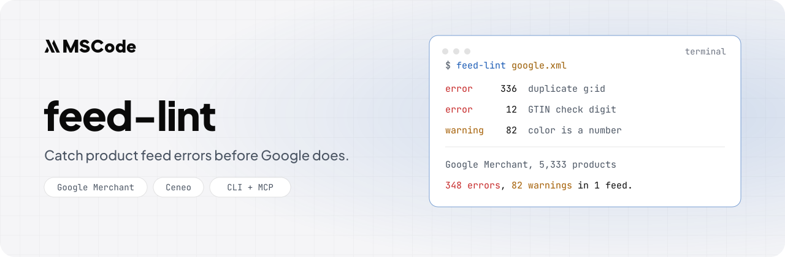

<p align="center">
  <picture>
    <source media="(prefers-color-scheme: dark)" srcset=".github/banner-dark.svg">
    
  </picture>
</p>

<p align="center">
  <a href="https://www.npmjs.com/package/@mscode-pl/feed-lint"></a>
  <a href="https://www.npmjs.com/package/@mscode-pl/feed-lint"></a>
  <a href="https://github.com/mscode-pl/feed-lint/actions/workflows/ci.yml"></a>
  
  <a href="LICENSE"></a>
</p>

<p align="center">
  feed-lint checks Google Merchant and Ceneo XML product feeds before you upload them: missing fields, prices in the wrong format, GTINs with a bad check digit, duplicate ids, placeholder brands, wrong availability codes and links that do not load. Every finding has the line number and the product id, and points to the rule in the official specification.
</p>

<p align="center">
  <a href="#try-it">Try it</a> · <a href="#formats">Formats</a> · <a href="#what-it-checks">Rules</a> · <a href="#use-it-in-ci">CI</a> · <a href="#options">Options</a> · <a href="#use-it-from-code">API</a> · <a href="#use-it-from-an-ai-agent">AI agents</a>
</p>

## Try it

```bash
npx @mscode-pl/feed-lint https://shop.example/feed/google.xml
```

It takes a file, a URL or stdin, reads gzipped feeds, and streams the XML, so a feed with 100,000 products does not have to fit in memory. A 6.7 MB feed with 5,333 products takes about half a second. It needs Node 22 or newer, no account and no API key.

```
examples/google.xml  Google Merchant, 3 products
  error    1  preorder or backorder without a valid g:availability_date  google/availability-date
              line 37  id MUG-300-WHITE  missing for preorder
  error    1  g:brand is a placeholder like "N/A" or "Generic"; leave it empty instead  google/brand-placeholder
              line 40  id MUG-300-WHITE  "N/A"
  error    1  The same g:id is used by more than one product  google/duplicate-id
              line 32  id MUG-300-WHITE  first used on line 8
  error    1  GTIN has a wrong check digit  google/gtin-checksum
              line 16  id MUG-300-WHITE  "5901234123458"
  error    1  Price is not a number with an ISO 4217 currency, e.g. 15.00 PLN  google/price-format
              line 27  id MUG-300-BLACK  g:price "29,99 zł": use a dot as the decimal separator
  error    1  g:sale_price is not lower than g:price or uses another currency  google/sale-price
              line 15  id MUG-300-WHITE  sale 34.99 PLN, regular 29.99 PLN
  warning  1  Title or description is written mostly in capital letters  google/all-caps
              line 22  id MUG-300-BLACK  g:title
  warning  1  g:color is a number, a code, a single letter or a non-color like "multicolor"  google/color-value
              line 29  id MUG-300-BLACK  "212"
  warning  1  No g:gtin, no g:brand with g:mpn and g:identifier_exists is not "no"  google/identifiers
              line 21  id MUG-300-BLACK
  warning  1  Title has promotional text like "free shipping", "-50%" or "!!"  google/promo-text
              line 22  id MUG-300-BLACK  "FREE SHIPPING"

6 errors, 4 warnings in 1 feed.
```

Findings are grouped by rule, so a feed where 9,000 products miss a GTIN gives one line with a count and a few examples instead of 9,000 lines.

## Why

Merchant Center and Ceneo tell you what is wrong only after the upload, hours later, product by product, and some problems (a duplicate id, a price with a comma) quietly drop products instead of failing loudly. Feeds are usually generated by a shop platform or an export script, so the same bug repeats on every product and comes back after every deploy.

feed-lint runs the documented rules locally, in seconds, on the file the export just wrote. Put it in CI next to the code that generates the feed and a broken export never reaches the shop's ads.

## Formats

| Format | Detected by | Records |
| --- | --- | --- |
| Google Merchant RSS 2.0 | `<rss>` root, fields in the `g:` namespace (`http://base.google.com/ns/1.0`) | `<item>` |
| Google Merchant Atom 1.0 | `<feed>` root | `<entry>` |
| Ceneo | `<offers>` root | `<o>`, including incremental `update="1"` offers and the GPSR `<responsibleProducers>` and `<responsiblePersons>` lists |

Google fields are read with or without the `g:` prefix. Meta (Facebook) catalogs use the Google format, so the same rules apply to them. Files can be UTF-8, UTF-16, ISO-8859-2 or Windows-1250, as the XML declaration says.

## What it checks

`feed-lint --rules` prints all 101 rules. Errors are what gets a product or the whole feed rejected; warnings are what the specification asks you not to do, or what limits how a product is shown.

| Area | Google Merchant | Ceneo |
| --- | --- | --- |
| **Required fields** | `id`, `title`, `description`, `link`, `image_link`, `availability`, `price` | `id`, `url`, `price`, `avail` on `<o>`; `<cat>`, `<name>`, `<imgs>`, `<desc>`, `<attrs>`; only `id` for incremental updates |
| **Limits** | id 50, title 150, description 5,000, brand and mpn 70, up to 10 extra images, URL lengths | id 100, url 1,000, category 255, name 150, description 100,000, 20 images, 500 attributes |
| **Values** | availability, condition, gender, age group, yes/no fields, energy class, ISO 8601 dates | `avail` codes 1, 3, 7, 14, 90, 99, 110; `basket`; `stock`; `weight`; energy class; CE mark |
| **Prices** | `15.00 PLN` format, real ISO 4217 code, at most 2 decimals, not 0, sale price lower than the price | dot as the decimal separator, 0 only in incremental mode |
| **Identifiers** | GTIN length, check digit, restricted and coupon prefixes; GTIN or brand + MPN or `identifier_exists=no` | "Kod EAN" 8 or 13 digits with check digit, "Kod ISBN", "Kod leku", "Marka" or "Producent" present |
| **Duplicates** | the same `g:id` twice | the same offer `id` twice, the same attribute twice in one offer |
| **Content** | all caps, "free shipping" and "!!" in titles, HTML in plain-text fields, colors given as numbers or codes, placeholder brands | commercial text in names, temporary categories like "Promocja", HTML tags outside the allowed list, HTML without CDATA |
| **Links** | http(s) only, https preferred, image URLs ASCII, known image formats | http(s) only; GPSR ids that exist in the lists |

With `--check-urls` it also requests product pages and images (HEAD, then GET if the server refuses HEAD) and reports pages that do not load (404, 5xx, timeouts) as errors, and redirects and pages that refuse the check (401, 403, 429) as warnings.

Rules come from the [Google Merchant product data specification](https://support.google.com/merchants/answer/7052112) and the [Ceneo XML guide](https://www.ceneo.pl/poradniki/Instrukcja-tworzenia-pliku-XML). Every finding links to its source.

## Use it in CI

Commit a config file so everyone runs the same check:

```json
{
  "feeds": ["public/feeds/google.xml", "public/feeds/ceneo.xml"],
  "ignore": ["google/identifiers"],
  "failOn": "error",
  "checkUrls": false
}
```

Save it as `feed-lint.config.json`, and `feed-lint` with no arguments uses it.

### GitHub Action

The action marks findings on the feed file in the pull request, and posts the full report as one comment that it updates on every push instead of adding a new one.

```yaml
name: Feeds

on: pull_request

permissions:
  contents: read
  pull-requests: write

jobs:
  feed-lint:
    runs-on: ubuntu-latest
    steps:
      - uses: actions/checkout@v4
      # Generate the feeds first, e.g. php artisan feeds:export
      - uses: mscode-pl/feed-lint@v1
        with:
          feeds: storage/feeds/*.xml
```

To watch a live feed instead, run it on a schedule with the URL:

```yaml
on:
  schedule:
    - cron: '0 6 * * *'

jobs:
  feed-lint:
    runs-on: ubuntu-latest
    steps:
      - uses: mscode-pl/feed-lint@v1
        with:
          feeds: https://shop.example/feed/google.xml
          check-urls: true
```

| Input | Default | |
| --- | --- | --- |
| `feeds` | `feeds` from the config | Files, globs or URLs, separated by spaces or new lines |
| `ignore` | | Rules to skip, comma separated |
| `check-urls` | `false` | Also request product links and images |
| `url-limit` | config, then `200` | Unique URLs to check per feed, `0` for all |
| `fail-on` | config, then `error` | `error`, `warning` or `never` |
| `config` | `feed-lint.config.json` | Config file to read |
| `comment` | `true` | Post the report as a pull request comment |
| `github-token` | `github.token` | Token for the comment |
| `version` | the action's release | feed-lint version from npm |

Outputs: `report` (path to the Markdown report, also shown in the job summary) and `exit-code`. Pull requests from forks get a read-only token, so they get the annotations and the job summary but no comment.

### Any other CI

```yaml
- run: npx @mscode-pl/feed-lint storage/feeds/google.xml --format github -o feed-report.md
```

The exit code is `1` when there are errors (or warnings with `--fail-on warning`), `0` otherwise, and `2` for bad arguments or a feed that could not be read.

## Options

| Option | |
| --- | --- |
| `-i, --ignore <list>` | Rules to skip, e.g. `google/identifiers,ceneo/brand` |
| `--check-urls` | Also request product links and images |
| `--url-limit <n>` | Unique URLs to check per feed, `0` for all (default `200`) |
| `-f, --format <type>` | `text`, `json`, `markdown` or `github` |
| `-o, --output <file>` | Also save the report; `.json`, `.md` or plain text by extension |
| `--verbose` | Up to 20 examples per rule and links to the specification |
| `-q, --quiet` | Errors only |
| `--fail-on <level>` | `error`, `warning` or `never` |
| `--config <file>` | Config file (default `feed-lint.config.json`) |
| `--stdin` | Read the feed from stdin |
| `--rules` | List all rules |

`--check-urls` sends 8 requests at a time with a 10 second timeout and checks the first 200 unique URLs by default, so it does not hammer your own shop. Raise `--url-limit` for a full check.

## Use it from code

```ts
import { createReadStream } from 'node:fs';
import { lintFeed } from '@mscode-pl/feed-lint';

const result = await lintFeed(createReadStream('google.xml'), { ignore: ['google/identifiers'] });

result.format; // 'google'
result.records; // 5333
for (const r of result.results) {
  console.log(r.level, r.rule, r.count, r.samples[0]?.line);
}
```

`lintFeed` takes any iterable of strings or bytes (a file stream, `fetch(...).body`, an array with the XML). Options: `ignore`, `maxSamples` (examples kept per rule, default 20) and `checkUrls` (`true` or `{ limit, concurrency, timeoutMs }`).

## Use it from an AI agent

### MCP server

`feed-lint mcp` starts an [MCP](https://modelcontextprotocol.io) server on stdio, so Claude, Cursor, VS Code and other MCP clients can check a feed while they work on the export code. It has two read-only tools:

| Tool | What it does |
| --- | --- |
| `lint_feed` | Lints a `path`, a `url` or `xml` passed inline and returns every rule hit with counts, lines, product ids and the source link. With none of them, it lints the feeds from `feed-lint.config.json`. |
| `explain_rule` | For one rule id, says how severe it is, how to fix it and where the specification says so. |

Claude Code:

```bash
claude mcp add feed-lint -- npx -y @mscode-pl/feed-lint mcp
```

Cursor, VS Code, Claude Desktop and others take the same command in their MCP config:

```json
{
  "mcpServers": {
    "feed-lint": {
      "command": "npx",
      "args": ["-y", "@mscode-pl/feed-lint", "mcp"]
    }
  }
}
```

### Agent Skill

The repo ships an [Agent Skill](skills/feed-lint/SKILL.md) for Claude Code, Codex, Cursor and other agents. It finds the code that generates the feed, runs feed-lint on its output and fixes the export instead of the XML.

```bash
npx skills add mscode-pl/feed-lint
```

## What it does not check

- Category-specific required attributes: Google's apparel rules per country and Ceneo's key attributes per category need their taxonomies, which are not bundled yet.
- Whether the price and availability in the feed match the product page. Both Google and Ceneo check this and hide offers that do not match.
- Image size and content. Google's 500 x 500 minimum starts on 31 January 2027.

## Contributing

```bash
pnpm install
pnpm test
pnpm build && node dist/cli/main.js examples/google.xml examples/ceneo.xml
```

Each rule lives in `src/rules/google.ts` or `src/rules/ceneo.ts` with a link to the paragraph of the specification it comes from, and has a test in `tests/`. Issues with a feed that gets a false report are welcome; strip prices and names you cannot share.

## License

MIT

---

<p align="center">
  <a href="https://mscode.pl">
    <picture>
      <source media="(prefers-color-scheme: dark)" srcset=".github/mscode-logo-white.svg">
      
    </picture>
  </a>
</p>

<p align="center">
  Built and maintained by <a href="https://mscode.pl">MSCode</a>, a Polish software house that makes websites and web and mobile apps.
</p>

<p align="center">
  <a href="https://mscode.pl">mscode.pl</a> · <a href="https://github.com/mscode-pl">More packages</a> · <a href="https://github.com/mscode-pl/feed-lint/issues">Report an issue</a>
</p>
